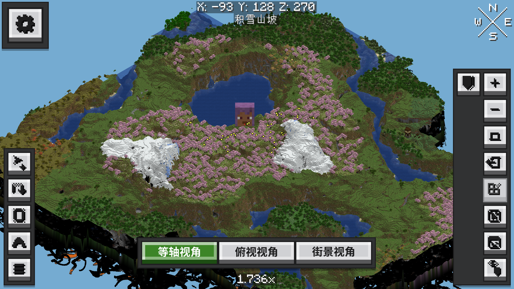
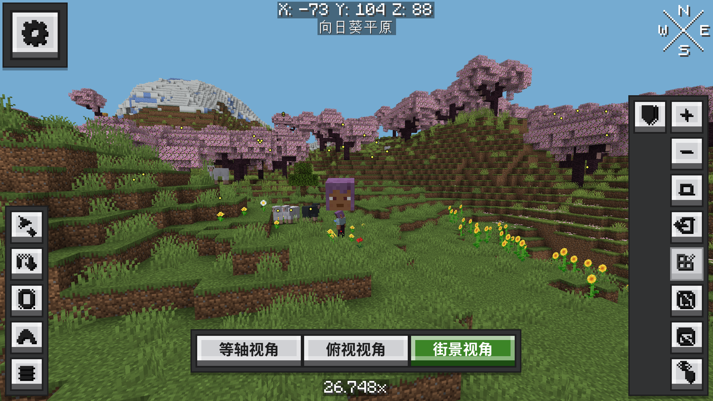
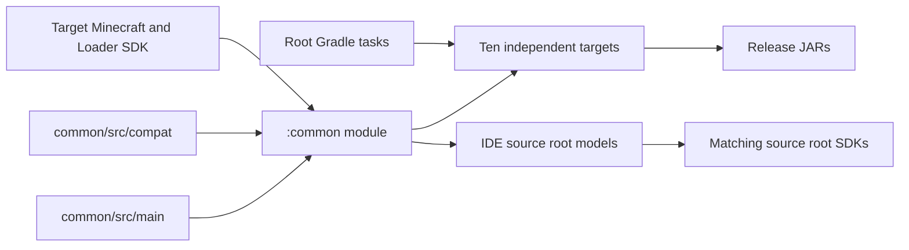

# Xaero's World Map: Earth

**3D terrain, three camera views and an Ore-style interface for Xaero's World Map.**

[Download](https://github.com/kltyton/XaeroWorldMapEarth/releases/latest) · [中文介绍](publishing/curseforge/text/zh_cn.md) · [Report an issue](https://github.com/kltyton/XaeroWorldMapEarth/issues)

Earth is a client-side addon for Xaero's World Map. Explore your world in 3D with Minecraft block models and resource-pack textures, switch between isometric, top-down and street views, and keep using your Xaero maps and waypoints.



## Download and installation

Download the JAR for your Minecraft version and loader, then place it in your client's `mods` folder.

**Required:**

- [Xaero's World Map](https://www.curseforge.com/minecraft/mc-mods/xaeros-world-map)
- [XaeroLib (Xlib)](https://www.curseforge.com/minecraft/mc-mods/xaerolib)
- [Fabric API](https://www.curseforge.com/minecraft/mc-mods/fabric-api) for Fabric releases

**Optional:** [Xaero's Minimap](https://www.curseforge.com/minecraft/mc-mods/xaeros-minimap) adds entity models to the map, using its radar filters and server permissions.

The 0.1.3 downloads below bundle KltytonUI 1.3.1 and its NeonJS runtime.

The current source limits detailed block geometry around the active focus according to zoom and the configured radius. Distant terrain uses Xaero's coarser mapped heights and colors. In surface mode, Earth starts with sections around the heightmap and follows exposed air into deeper sections at cave openings and overhangs. Set `isometricDetailDistance` between 64 and 1536 to change the maximum radius.

Earth terrain is enabled by default in Xaero's framebuffer minimap. Set `minimap3d=false` to use Xaero's original terrain. The world map and minimap share the saved map view, isometric yaw and pitch. Free-view rotation and movement last until you leave free view or close the world map. Xaero's terrain fills the minimap while Earth terrain is loading.

Use Xaero's Minimap Settings to change **Zoom** for the area shown and **Size** for the HUD frame. Earth follows the native zoom, including minimap zoom keybinds, and Xaero's north-lock setting. Earth starts at 1.5 times Xaero's zoom. Set `minimapZoomMultiplier` to `1.0` in `config/xaeroearth-client.toml` (Forge and NeoForge) or `config/xaeroearth-client.properties` (Fabric) for the native scale. Enable `minimapFollowWorldZoom` in the same file for a bounded adjustment based on world-map zoom.

The world-map context menu offers **Navigate here** and **Auto-navigate here**. Both show a 3D route in the world and Earth maps and a circular terrain scan with a white wavefront and cyan contours. Auto-navigation steers the player or a controlled mount. Press the sprint key during ground navigation to request sprinting. When already gliding with an elytra, auto-navigation steers toward the destination and can use firework rockets held in either hand. The HUD shows the distance to the destination. Press Escape to clear navigation, or double-press or hold a movement key to cancel auto-navigation.

Client scripts with Java interop can configure subsequent scans with `TerrainScan.setProfile`. The arguments are the burst, travel and fade durations in ticks, the radius at the end of each phase in blocks, the contour spacing in blocks, and the full sector angle in degrees.

```js
const TerrainScan = Java.type('io.github.kltyton.xaeroearth.client.render.navigation.TerrainScan');
TerrainScan.setProfile(4, 24, 10, 5, 28, 36, 1.45, 360);
```

With a CompanionCall build that provides its map API, the world map shows controllable companions tracked by the client in the current dimension. Click a portrait to select it, Shift-click to change the selection, or Shift-drag on the map to select companions in a rectangle. Click mapped ground to send up to 32 selected companions there. CompanionCall authorizes and moves the companions on the server. The integration applies to the eight shared Minecraft and loader targets. Forge 1.18.2 and 1.19.2 have player navigation only.

### Version 0.1.3

| Minecraft | Loader | Java | Download |
| --- | --- | --- | --- |
| 1.18.2 | Forge | 17 | [forge-1.18.2](https://github.com/kltyton/XaeroWorldMapEarth/releases/download/v0.1.3/xaero-world-map-earth-forge-1.18.2-0.1.3.jar) |
| 1.19.2 | Forge | 17 | [forge-1.19.2](https://github.com/kltyton/XaeroWorldMapEarth/releases/download/v0.1.3/xaero-world-map-earth-forge-1.19.2-0.1.3.jar) |
| 1.20.1 | Forge | 17 | [forge-1.20.1](https://github.com/kltyton/XaeroWorldMapEarth/releases/download/v0.1.3/xaero-world-map-earth-forge-1.20.1-0.1.3.jar) |
| 1.20.1 | Fabric | 17 | [fabric-1.20.1](https://github.com/kltyton/XaeroWorldMapEarth/releases/download/v0.1.3/xaero-world-map-earth-fabric-1.20.1-0.1.3.jar) |
| 1.21.1 | Fabric | 21 | [fabric-1.21.1](https://github.com/kltyton/XaeroWorldMapEarth/releases/download/v0.1.3/xaero-world-map-earth-fabric-1.21.1-0.1.3.jar) |
| 1.21.1 | NeoForge | 21 | [neoforge-1.21.1](https://github.com/kltyton/XaeroWorldMapEarth/releases/download/v0.1.3/xaero-world-map-earth-neoforge-1.21.1-0.1.3.jar) |
| 26.1.2 | Fabric | 25 | [fabric-26.1.2](https://github.com/kltyton/XaeroWorldMapEarth/releases/download/v0.1.3/xaero-world-map-earth-fabric-26.1.2-0.1.3.jar) |
| 26.1.2 | NeoForge | 25 | [neoforge-26.1.2](https://github.com/kltyton/XaeroWorldMapEarth/releases/download/v0.1.3/xaero-world-map-earth-neoforge-26.1.2-0.1.3.jar) |
| 26.2 | NeoForge | 25 | [neoforge-26.2](https://github.com/kltyton/XaeroWorldMapEarth/releases/download/v0.1.3/xaero-world-map-earth-neoforge-26.2-0.1.3.jar) |
| 26.2 | Fabric | 25 | [fabric-26.2](https://github.com/kltyton/XaeroWorldMapEarth/releases/download/v0.1.3/xaero-world-map-earth-fabric-26.2-0.1.3.jar) |

## Features

| Feature | Description |
| --- | --- |
| 3D terrain | Terrain and buildings use Minecraft block models and your resource-pack textures. Distant areas use Xaero's recorded colors and heights, with details updated as models load. |
| Three camera views | Isometric, top-down and street views, with rotation, zoom and a freely movable street-view camera. |
| Ore-style interface | Map controls, settings pages, dropdowns, sliders and menus use Ore-McUI styling. |
| Waypoints | Create, edit and delete waypoints through Xaero's existing menus. |
| Player and entity markers | Player heads use current skins and stay bright in caves. Optional Minimap integration displays permitted loaded entities as models. |
| Worlds and caves | Browse Xaero's worlds, dimensions and cave layers using your existing map data. |
| Theme toggle | Switch between Earth and Xaero's original interface through the theme setting. |



## Controls

| Action | Input |
| --- | --- |
| Open the map | Xaero's World Map key, `M` by default |
| Pan in isometric or top-down view | Left-drag |
| Rotate in isometric view | Middle-drag |
| Reset the isometric view angle | Double-click the Isometric view button |
| Zoom | Mouse wheel |
| Change view | View buttons at the bottom of the map |
| Turn the street-view camera | Left- or middle-drag |
| Move the street-view camera | `WASD`, `Space` to rise, `Shift` to descend |
| Manage waypoints | Xaero's context menus and waypoint interface |

## Building from source

The project uses [KltytonTemple 1.6.0](https://github.com/kltyton/KltytonTemple/tree/3cfe9ad791c8939d0efc51c7771aef4830f160c2). Each directory under `targets/` is an independent Gradle project with its own Wrapper, Java toolchain and `:common` module. Shared map state, cameras, tile processing, column encoding and UI state live in `common/src/main`; native Minecraft and loader API adapters live in `common/src/compat`. Each target selects its compatibility profiles through `temple_compatibility`.

Use the Java version listed above. Gradle resolves the pinned [KltytonUI](https://github.com/kltyton/KltytonUI) release for the selected target from Sighs Maven.



KltytonUI provides block-model baking, chunk mesh drawing, and the UI runtime. This addon owns map cameras, world and dimension sessions, tile caches, map surfaces, entity models, and player portrait indicators.

For example, on Windows:

```powershell
cd targets/neoforge-26.2
.\gradlew.bat assemble --no-daemon
```

On Linux or macOS, use `./gradlew` with the same arguments. Release JARs are written to the target's `build/libs/` directory. Earth 26.1.2 targets use the matching KUI 26.1 target.

The root Gradle project provides `listTargets`, `select_<target>`, `build_<target>`, `assemble_<target>` and `assembleAllTargets`. Task suffixes replace hyphens and dots with underscores, for example `assemble_neoforge_26_2`. Pass each local UI JAR as `-PkuiJar.<target>=<path>` when invoking the root controller. `verifyAllDistributions` inspects recorded release JARs without rebuilding them.

All target tasks beginning with `publish` verify the production JAR before publishing. The project keeps its KUI path forwarding, client-only metadata and bundled-library checks. `createProject` offers Groovy and Kotlin DSL; this project continues to use `temple_build_dsl=groovy`.

Import the root project in IDEA with the KltytonTemple extension to link all ten independent targets. Selection controls the root task aliases and the SDK used to edit shared `common` sources. With extension 1.6.0, reload all target Gradle models to assign the other compatibility directories to matching SDK modules. The extension keeps matching Gradle JDKs and removes associations for deleted targets. Each physical source or resource directory has one owner. Schema 2 source models include build input fingerprints and the production source inventory; `verifySourceLayout` checks them without rebuilding or synchronizing. The models use the actual target directory IDs and remain under `common/.gradle/contexts`.

Both project creation forms offer a default editing target from the selected matrix. Existing projects keep their root `temple_default_target` and any local `.temple/active-target` selection.

Use the same Maven configuration for IDE imports and task buttons. Use `-PkuiJar` to explicitly select a matching local build.

## Credits and license

Developed by [kltyton](https://github.com/kltyton). Earth is licensed under [MIT](LICENSE).

- [Xaero's World Map](https://www.curseforge.com/minecraft/mc-mods/xaeros-world-map), XaeroLib and Xaero's Minimap by Xaero96.
- [KltytonUI](https://github.com/kltyton/KltytonUI) by kltyton, based on ApricityUI by Tower of Sighs and contributors, licensed under LGPL-2.1.
- NeonJS and its third-party components, documented in the bundled library notices.
- OreUI / mcui-oreui and Vue contributors.
- [KltytonTemple](buildSrc/LICENSE) build tooling, licensed under MIT.

Bundled-library licenses and source links are listed in [Third-party notices](licenses/NOTICE.md).
