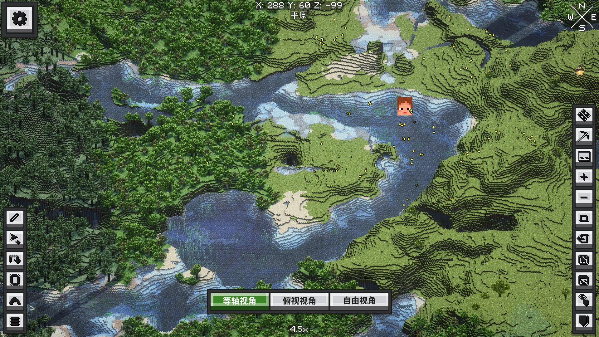
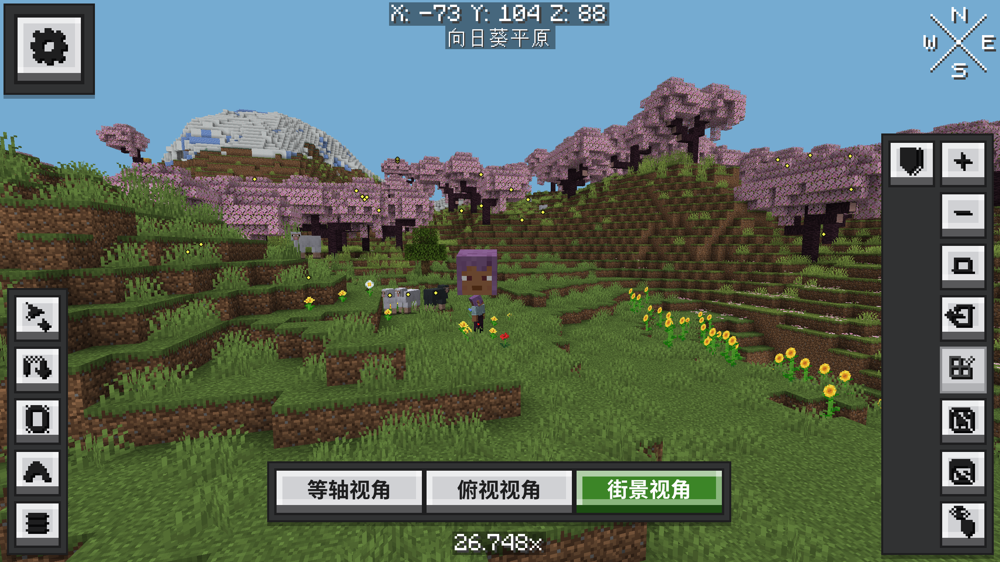
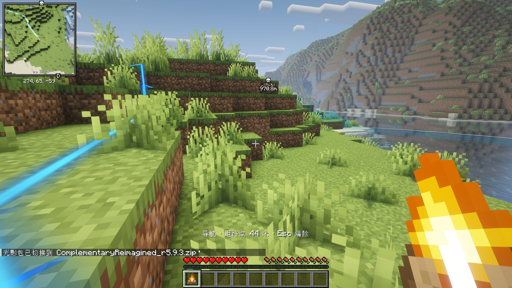
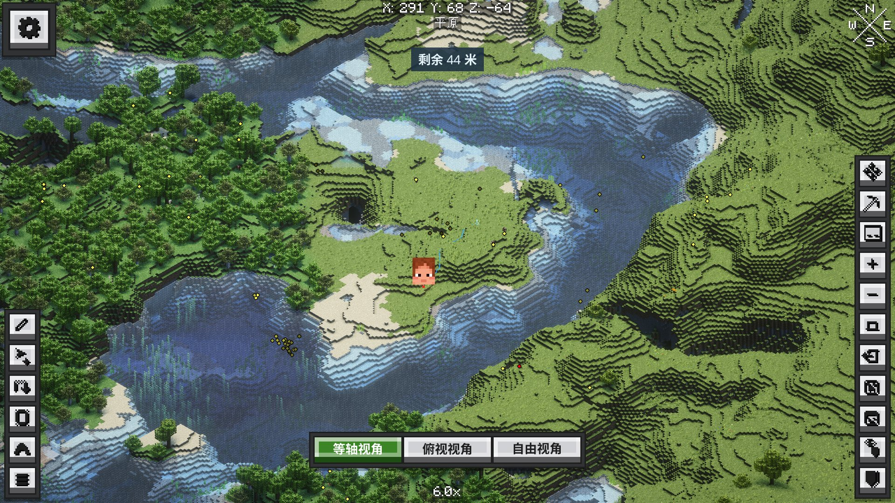
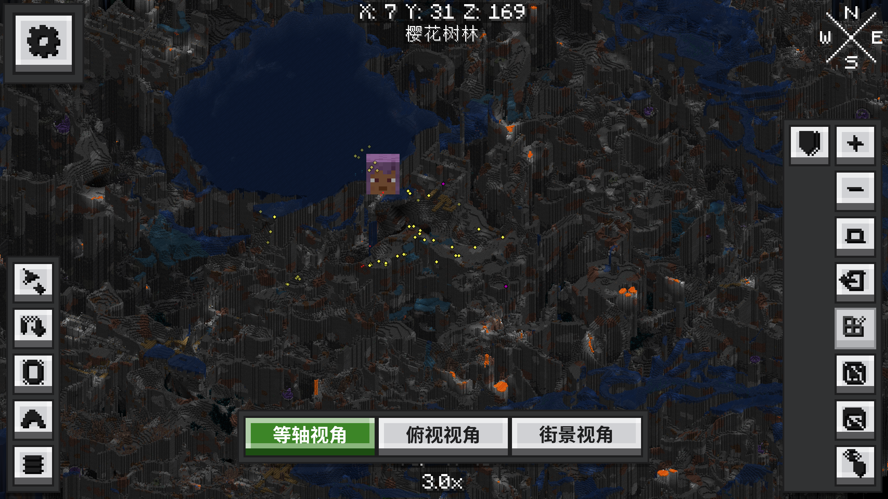

# Xaero's World Map: Earth

EarthView (Xaero's World Map: Earth) is a client-side addon for [Xaero's World Map](https://www.curseforge.com/minecraft/mc-mods/xaeros-world-map), inspired by Google Earth.

It turns your flat map into 3D terrain using Minecraft's block models and your current resource pack. Rotate, zoom and tilt the map, apply your shader pack, display a 3D minimap, draw and measure on the terrain, or click a destination and let the game guide or walk you there. Map controls and settings use an Ore-McUI theme. Your Xaero maps and waypoints stay available, and you can switch back to the original interface in settings.

## Features

### 3D terrain and detail modes

Explore valleys, tree canopies, cave openings, builds and translucent water. Unexplored areas fade into fog. Switch between **Detail** and **Fast** terrain modes. Earth saves terrain to disk for faster revisits, and in singleplayer you can enable background loading of nearby terrain that has already been generated.

### Three camera views

Switch between **Isometric**, **Top-down** and **Street view**. Middle-drag in isometric view to rotate or tilt the map. In street view, use the keyboard to move the camera near the ground and inspect your builds and terrain.

### Earth Shaders

With Iris or Oculus installed, the shader selection screen adds an **Earth Shaders** toggle. Use the active shader pack's lighting, shadows and water effects on the 3D world map and minimap. The toggle lets you keep world shaders enabled while using standard map rendering.

### 3D minimap HUD

With [Xaero's Minimap](https://www.curseforge.com/minecraft/mc-mods/xaeros-minimap), the HUD can show the same 3D terrain. Its zoom is independent, and its pitch follows the world map. With north lock enabled, its yaw also follows the world map. With north lock disabled, it follows the player's heading.

### Navigation and auto-navigation

Right-click a destination on the world map and choose one of two options.

- **Navigate here** displays a blue line that follows the terrain, a highlighted destination and the remaining distance. The guide appears in the world, on the world map and on the minimap HUD. Press Esc to clear it.
- **Auto-navigate here** steers the player and handles walking, sprint input and climbing steps. It continues planning ahead on long routes and can wait for terrain at unloaded chunk boundaries. It also supports swimming and diving, controlled mounts, creative flight and elytra gliding. When conditions allow, it can use a firework rocket held in either hand. Double-press or hold a movement key to take over.

### Drawing, annotations and measurements

Use the map toolbar or context menu to draw freehand lines or polylines, outline regions, write annotations, and add Earth landmarks that you can rename or remove. The two-point ruler reports horizontal distance and straight-line 3D distance.

### Xaero maps, waypoints and cave layers

Earth uses Xaero's existing waypoints, world and dimension selection, and cave layers. Your player marker uses the head from your current skin and stays visible in dark caves.

## Controls

| Action | Input |
| --- | --- |
| Open the world map | Xaero's World Map key, **M** by default |
| Pan the map | Left-drag in isometric or top-down view |
| Rotate or tilt | Middle-drag in isometric view |
| Zoom | Mouse wheel |
| Change view | Use the Isometric, Top-down or Street view buttons below the map |
| Move or turn in street view | Left- or middle-drag to turn. Use **WASD** to move, **Space** to rise and **Shift** to descend. |
| Navigate or annotate | Right-click a map position and select a tool. Press **Esc** to clear navigation or cancel the current drawing. |
| Waypoints and map settings | Use Xaero's context menu, waypoint screen and the settings button in the upper-left corner. |

## Optional integrations

- [Xaero's Minimap](https://www.curseforge.com/minecraft/mc-mods/xaeros-minimap) adds the 3D HUD and lets the map display nearby entities allowed by the minimap's radar filters and server permissions.
- [CompanionCall](https://www.mcmod.cn/class/32709.html) lets you select controllable companions, pets and mounts using their portraits. Shift-click to change the selection or Shift-drag to select a group, then click the ground to issue a move command. Use a compatible CompanionCall version for your loader.
- Iris and Oculus supply the active shader pack for Earth Shaders on the world map and minimap.

## Installation

Install the file for your Minecraft version and loader on the client. Install [Xaero's World Map](https://www.curseforge.com/minecraft/mc-mods/xaeros-world-map) and [XaeroLib](https://www.curseforge.com/minecraft/mc-mods/xaerolib), plus [Fabric API](https://www.curseforge.com/minecraft/mc-mods/fabric-api) for Fabric. Version 0.1.4+hotfix bundles KltytonUI 1.3.2.1 and its NeonJS runtime.

| Minecraft | Loaders | Java |
| --- | --- | --- |
| 1.18.2 | Forge | 17 |
| 1.19.2 | Forge | 17 |
| 1.20.1 | Forge, Fabric | 17 |
| 1.21.1 | NeoForge, Fabric | 21 |
| 26.1.2 | NeoForge, Fabric | 25 |
| 26.2 | NeoForge, Fabric | 25 |

## Similar projects

- [Map 3D usseewa](https://www.mcmod.cn/class/30475.html)
- [x3d 地图](https://www.mcmod.cn/class/27555.html)

I only learned about these projects from friends who helped test Earth. I developed Earth independently, without copying or using those projects as references.

## Author and links

Developed by kltyton. Earth uses the MIT license. See the third-party notices for bundled libraries and their licenses.

[Source](https://github.com/kltyton/XaeroWorldMapEarth) · [Issues](https://github.com/kltyton/XaeroWorldMapEarth/issues) · [Third-party notices](https://github.com/kltyton/XaeroWorldMapEarth/blob/main/licenses/NOTICE.md)
